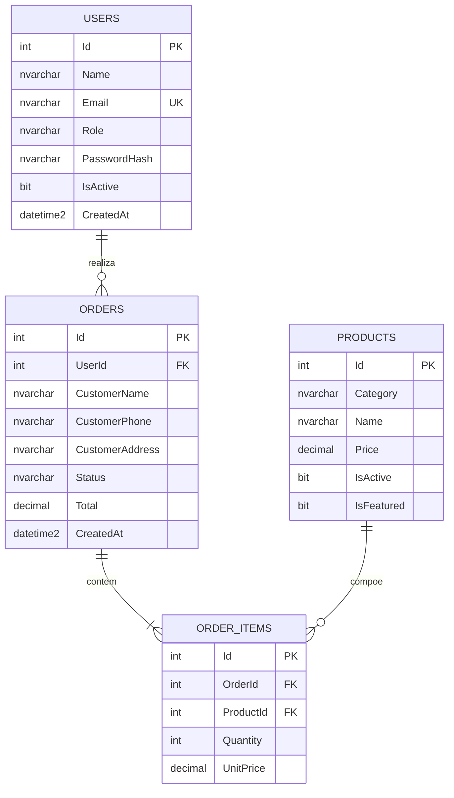

# Banco de dados FOODSMART

## Estrutura identificada

O banco utiliza SQL Server e possui quatro entidades centrais:

- `Users`: contas, e-mail único, função e hash de senha.
- `Products`: catálogo, preço e disponibilidade.
- `Orders`: dados do cliente, status, total e usuário opcional.
- `OrderItems`: itens do pedido, quantidade e preço registrado na compra.

## Relacionamentos

- `Users (1) -> (0..N) Orders`; `Orders.UserId` é opcional e usa `ON DELETE SET NULL`.
- `Orders (1) -> (1..N) OrderItems` no fluxo normal de criação; FK com `ON DELETE CASCADE`.
- `Products (1) -> (0..N) OrderItems`; exclusão física de produto é restrita para preservar histórico.

## Integridade adicionada ao modelo EF

- Preço do produto maior que zero.
- Total do pedido não negativo.
- Quantidade de item maior que zero.
- Preço unitário não negativo.
- Índices para catálogo ativo/categoria, data/status dos pedidos e FKs dos itens.
- E-mail com collation case-insensitive para reduzir duplicidade por diferença de maiúsculas/minúsculas (validar a collation real do banco antes de aplicar mudança física).

## Objetos SQL incluídos

O arquivo `sql/01_atualizacao_segura.sql` contém:
- Check constraints;
- Índices auxiliares;
- Procedure `dbo.usp_FoodSmart_OrderSummary`;
- Trigger `dbo.TR_Orders_ValidateStatusTransition`.

A trigger reforça no SQL Server as mesmas transições permitidas pela API:
`Recebido -> Preparando/Cancelado`,
`Preparando -> Saiu para entrega/Cancelado`,
`Saiu para entrega -> Concluído/Cancelado`.
`Concluído` e `Cancelado` são estados finais.

## Como aplicar

1. Faça backup completo do banco `FoodSmartDb` pelo SSMS.
2. Teste o script em uma cópia/restauração do banco.
3. Confira se os dados existentes respeitam os CHECK constraints.
4. Execute `sql/01_atualizacao_segura.sql` no banco correto.
5. Valide os objetos em `sys.check_constraints`, `sys.indexes`, `sys.procedures` e `sys.triggers`.

**Não execute em produção sem backup e validação.** O script não apaga tabelas nem registros, mas a criação de constraints falhará se houver dados antigos incompatíveis.

## Migrations EF Core: decisão de segurança

O projeto atual inicializa o banco com `EnsureCreated()` e possui um ajuste manual para `Orders.UserId`. Isso não é um histórico de migrations. Criar uma migration inicial e aplicá-la diretamente sobre um banco já existente pode tentar recriar tabelas e causar conflito.

Por isso, não foi gerada/aplicada uma migration automática nesta revisão. Para adotar migrations:
1. Faça backup.
2. Gere uma migration inicial em banco vazio de desenvolvimento.
3. Compare o SQL gerado com o esquema real de `FoodSmartDb`.
4. Faça baseline controlada (registro em `__EFMigrationsHistory`) somente após garantir equivalência.
5. A partir daí, use `Database.Migrate()` e migrations futuras. Não misture `EnsureCreated()` com migrations.

## MER simplificado

